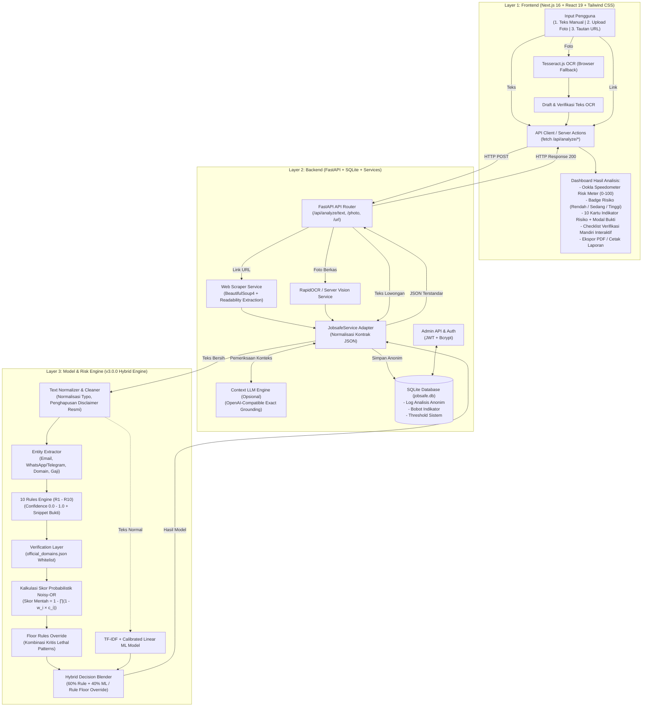

# DOKUMENTASI ARSITEKTUR LENGKAP SISTEM JOBSAFE
**Platform Penilaian Risiko Lowongan Kerja Digital (*Digital Job Recruitment Risk Assessment*)**

---

## 📌 1. Ringkasan Eksekutif & Filosofi Desain

**JOBSAFE** adalah platform digital independen yang dirancang untuk membantu masyarakat, mahasiswa, dan pencari kerja digital di Indonesia dalam menilai tingkat risiko penipuan atau eksploitasi pada suatu tawaran lowongan kerja secara mandiri, objektif, transparan, dan dapat dipertanggungjawabkan (*explainable*).

### Prinsip Utama Sistem:
1. **Bukan Vonis Hukum Mutlak (*No Absolute Verdict*):** Sistem tidak mencap "penipu" atau "asli" secara hitam-putih, melainkan menyajikan **Risk Score (0–100)** berbasis bukti (*evidence-grounded*), disertai dasar hukum positif Indonesia (Kemnaker/UU Ketenagakerjaan/BP2MI) serta dasar pertimbangan etika/syariah.
2. **Explainable AI (XAI) & Rule-First:** Berbeda dengan model *black-box* yang tidak dapat menjelaskan alasannya, JOBSAFE menyajikan kutipan kalimat bukti (*evidence snippet*) dari lowongan yang memicu masing-masing dari **10 Indikator Risiko Digital**.
3. **Privasi Penuh Sesuai UU PDP (UU No. 27 Tahun 2022):** Pengguna tidak memerlukan registrasi/login, tidak dimintai data pribadi (nama, KTP, nomor HP, email), teks masukan tidak dikaitkan dengan identitas pengguna, dan sistem penyimpanan log hanya mencatat data analitik yang dianonimkan (*anonymized audit log*).
4. **Resiliensi & Graceful Fallback:** Sistem dirancang dengan arsitektur berlapis (*layered redundancy*). Jika modul Machine Learning atau OCR server tidak tersedia, sistem secara mulus beralih ke Rule-Based Engine lokal dan OCR browser.

---

## 🏛️ 2. Diagram Arsitektur Global (End-to-End)

Berikut adalah diagram arsitektur interaksi menyeluruh antara **Frontend**, **Backend**, dan **Model**:



---

## 💻 3. Arsitektur Layer 1: FRONTEND (Web Interface)

Frontend dibangun dengan standar modern menggunakan **Next.js 16 (App Router)**, **React 19**, **TypeScript**, dan **Tailwind CSS**.

### A. Input (Masukan Pengguna)
Frontend menyediakan 3 pintu masuk data pada halaman `/periksa`:
1. **Tab 1 — Teks Lowongan (`activeTab: "text"`):**
   - `Textarea` responsif dengan validasi batas minimal 20 karakter.
   - Pilihan cepat (*Preset Buttons*): Contoh lowongan Risiko Tinggi (tugas like/deposit), Risiko Sedang (komunikasi WA saja), dan Risiko Rendah (lowongan resmi dengan email korporat).
2. **Tab 2 — Foto / Poster (`activeTab: "photo"`):**
   - *File Uploader* pendukung berkas gambar (`PNG`, `JPG`, `JPEG`) hingga ukuran 10 MB.
   - *Client-side OCR Extraction* menggunakan library **Tesseract.js**. Teks yang diekstrak langsung ditampilkan ke pengguna dalam kotak *Draft Review* agar pengguna dapat mengoreksi kata atau nomor kontak sebelum dikirim ke backend.
3. **Tab 3 — Tautan / Link Web (`activeTab: "link"`):**
   - Kolom isian URL dengan validasi protokol (`http://` atau `https://`).
4. **Portal Admin (`/admin/login`):**
   - Form otentikasi aman berbasis kredensial email & password administrator.

### B. Proses (Logika & Antarmuka)
1. **Simulasi Loading Progresif (`LoadingAnalysis.tsx`):**
   - Menampilkan animasi bertahap (5 langkah) selama analisis berlangsung:
     1. Membaca & membersihkan konten teks.
     2. Menemukan entitas (email, kontak, tautan).
     3. Memeriksa 10 indikator risiko digital.
     4. Menganalisis dimensi finansial & proses rekrutmen.
     5. Mengkalkulasi skor risiko terukur.
2. **Kalkulasi Meter Pengukur Kecepatan Ookla (`RiskGauge.tsx`):**
   - **Desain & Tema Latar:** Mengusung latar belakang putih bersih (`bg-white`) yang terintegrasi secara harmonis dengan tema kartu aplikasi, dilengkapi bezel dial instrumen modern (`#f8fafc` s/d `#f1f5f9`), teks angka wisuda kontras tinggi (`#475569`), dan kanal meteran abu-abu terang (`#e2e8f0`).
   - **Geometri Dial:** Menggunakan kurva tapal kuda 240 derajat (mulai dari sudut 150° di kiri bawah hingga sudut 390°/30° di kanan bawah).
   - **Skala Wisuda (Graduation Scale):** Titik ukur reguler setiap 5 unit, dengan angka utama `0`, `25`, `50`, `75`, `100` yang diposisikan presisi di sepanjang lingkaran dalam.
   - **Jarum Tachometer (Tapered Needle):** Jarum poligon meruncing dari poros pusat (`cx: 150, cy: 130`) ke ujung jarum. Jarum berputar secara dinamis sesuai skor dengan interpolasi transisi `cubic-bezier(0.34, 1.25, 0.64, 1)` untuk menghasilkan efek pegas presisi khas speedometer.
   - **Pemetaan Warna Dinamis Sesuai Risiko:**
     - **Hijau (Risiko Rendah, Skor 0–24):** Stroke `#10b981`, glow hijau zamrud, badge hijau lembut.
     - **Kuning/Amber (Risiko Sedang, Skor 25–59):** Stroke `#f59e0b`, glow emas amber, badge kuning hangat.
     - **Merah (Risiko Tinggi, Skor 60–100):** Stroke `#ef4444`, glow merah kirmizi, badge merah peringatan.
3. **Pra-Pemrosesan Teks & Normalisasi Artefak OCR (`normalizeRecruitmentText`):**
   - **Perbaikan Glitch Spasi OCR:** Memulihkan huruf yang terpisah spasi secara acak (misal: `g a j i` $\rightarrow$ `gaji`, `b i a y a` $\rightarrow$ `biaya`, `k e r j a` $\rightarrow$ `kerja`, `1 0 0 j u t a` $\rightarrow$ `100 juta`).
   - **Pemisahan Angka & Satuan:** Memastikan token tersambung seperti `100juta`, `5jam`, `10jt` dipisahkan menjadi `100 juta`, `5 jam`, `10 juta`.
   - **Koreksi Leetspeak & Tipografi:** Mengonversi substitusi angka OCR yang umum (misal `g4ji` / `gaj1` $\rightarrow$ `gaji`, `k3rja` $\rightarrow$ `kerja`, `pend4ftaran` $\rightarrow$ `pendaftaran`, `dep0sit` $\rightarrow$ `deposit`).
   - **Deteksi Kontekstual Imbalan & Jam Kerja:** Menangkap gaji nominal fantastis (misal $\ge$ 20–100 juta), jam kerja sangat minim (misal 1–5 jam), serta rasio kerja-ke-imbalan yang tidak proporsional.
3. **State Management & Interaktivitas:**
   - Menyimpan status checklist verifikasi secara lokal (*client state*).
   - Menangani pembukaan modal dialog rincian indikator (`IndicatorModal.tsx`).
   - Penyesuaian mode cetak (*Print/PDF layout*) melalui utilitas CSS `@media print`.

### C. Output (Keluaran di Layar)
1. **Panel Instrumen Speedometer Ookla:**
   - Angka skor digital besar (misal: `72`), pembagi `/ 100`, dan badge status risiko (`🔴 RISIKO TINGGI`, `🟡 RISIKO SEDANG`, `🟢 RISIKO RENDAH`).
   - Keterangan rentang ambang batas dan pesan edukatif.
2. **Kartu Ringkasan Eksekutif & Tindakan Preventif:**
   - Paragraf ringkasan temuan bahasa Indonesia yang mudah dipahami.
   - Rekomendasi tindakan nyata yang harus segera diambil oleh calon pelamar.
3. **Grid 10 Kartu Indikator Risiko Digital (R1–R10):**
   - Setiap kartu menampilkan kode, nama indikator, bobot persentase, status (Risiko Tinggi, Perlu Perhatian, Aman), dan tombol "Lihat detail & alasan".
   - Saat diklik, modal menampilkan: kutipan kalimat teks yang menjadi bukti, alasan edukasi, dasar hukum formal, serta dasar etika syariah.
4. **Checklist Verifikasi Mandiri:**
   - 8 langkah verifikasi mandiri interaktif (cek domain web, email resmi, legalitas PT di Ditjen AHU, verifikasi nomor telepon rekruter di Getcontact, dll.) dengan indikator persentase penyelesaian.

---

## ⚙️ 4. Arsitektur Layer 2: BACKEND (FastAPI & Services)

Backend dibangun menggunakan **Python 3.10+** dengan framework berkecepatan tinggi **FastAPI**, memanfaatkan arsitektur asynchronous dan validasi tipe data ketat menggunakan **Pydantic**.

### A. Input (Endpoint API)
Backend mengekspos endpoint RESTful terstruktur:
| Method | Endpoint | Tipe Input | Deskripsi |
| :--- | :--- | :--- | :--- |
| `POST` | `/api/analyze/text` | JSON `{"text": str}` | Menerima teks mentah deskripsi lowongan kerja (minimal 20 karakter). |
| `POST` | `/api/analyze/photo` | `multipart/form-data` | Menerima berkas file gambar poster lowongan + teks draft OCR opsional. |
| `POST` | `/api/analyze/url` | JSON `{"url": str}` | Menerima URL tautan halaman lowongan kerja untuk di-*scrape*. |
| `GET` | `/api/public-indicators` | Query params | Menyediakan katalog 10 indikator aktif dan bobotnya untuk publik. |
| `POST` | `/api/admin/login` | JSON `{"email", "password"}` | Autentikasi admin, menghasilkan JWT Bearer Token. |
| `GET` | `/api/admin/dashboard` | Header `Authorization: Bearer <token>` | Statistik total analisis, distribusi risiko, dan metrik sistem. |
| `PUT` | `/api/admin/indicators`| Header `Authorization: Bearer <token>` | Memperbarui bobot atau status aktif 10 indikator risiko. |
| `PUT` | `/api/admin/settings` | Header `Authorization: Bearer <token>` | Mengatur ambang batas threshold (`low_max`, `high_min`). |

### B. Proses (Logika Pengolahan Backend)
1. **Web Scraper Service (`scraper_service.py`):**
   - Mengambil konten web dari URL lowongan menggunakan `requests` dengan header HTTP browser realistis (*User-Agent spoofing*) dan batas waktu *timeout* (8 detik).
   - Mem-parsing DOM dengan **BeautifulSoup4**, menyingkirkan elemen sampah (tag `<script>`, `<style>`, `<nav>`, `<footer>`), dan mengekstrak teks utama artikel lowongan.
2. **OCR Engine Service (`ocr_service.py`):**
   - Bertindak sebagai *server-side redundancy* jika pengguna mengunggah gambar langsung tanpa draft OCR browser.
   - Menggunakan **RapidOCR** (berbasis ONNX Runtime) atau **Tesseract** untuk mengenali teks pada gambar beresolusi tinggi.
3. **Model Service Bridge (`jobsafe_service.py` & `analyzer.py`):**
   - Mengimplementasikan pola *Adapter*: memanggil `JobsafeHybridEngine` dari direktori `Model/` dan mengadaptasi keluaran riset ke dalam skema kontrak JSON yang diharapkan oleh frontend.
   - Mengambil bobot indikator dan nilai ambang batas (*threshold*) terkini dari database SQLite.
4. **Analisis Semantik Kontekstual LLM (`context_llm.py`):**
   - Fitur opsional yang dapat diaktifkan jika env `OPENAI_API_KEY` terkonfigurasi.
   - Menggunakan model LLM (seperti `gpt-4o-mini`) untuk membaca konteks kalimat tersirat, negasi kompleks, atau indikasi manipulatif yang luput dari regex.
   - **Prinsip Anti-Halusinasi:** Kutipan bukti yang dikembalikan oleh LLM wajib dicek validasinya menggunakan string substring matching (`finding["evidence"] in text`). Jika kutipan tidak benar-benar ada di teks asli, temuan tersebut dibatalkan secara otomatis!
5. **Database & Audit Logging (`db.py`):**
   - Menggunakan database **SQLite** (`jobsafe.db`).
   - Menyimpan rekaman riwayat pemindaian secara anonim (id unik, timestamp, jenis input teks/foto/link, skor risiko, level risiko, daftar indikator terpicu).
   - Tidak ada IP address, nama pengguna, atau teks lengkap yang disimpan secara permanen demi kepatuhan UU PDP.

### C. Output (Keluaran Backend)
Backend mengembalikan respons JSON terstandarisasi dengan struktur:
```json
{
  "id": 142,
  "risk_score": 75,
  "risk_level": "RISIKO TINGGI",
  "level_code": "HIGH",
  "risk_color": "red",
  "risk_theme": "#dc2626",
  "summary": "Risiko Tinggi: ditemukan indikator kuat pemungutan biaya di awal dan kontak komunikasi tidak resmi.",
  "findings_summary": "...",
  "preventive_advice": "Jangan pernah mentransfer uang dengan alasan apa pun...",
  "indicators_detected_count": 2,
  "indicators_high_count": 1,
  "indicators_attention_count": 1,
  "indicators": [
    {
      "code": "R1",
      "name": "Biaya di Awal",
      "category": "Finansial",
      "weight": 15,
      "status": "RISIKO_TINGGI",
      "status_label": "! Risiko tinggi",
      "status_badge": "high",
      "description": "Permintaan biaya pendaftaran...",
      "why_important": "Rekrutmen resmi tidak pernah memungut biaya...",
      "matches_count": 1,
      "evidence": "wajib membayar biaya registrasi dan pelatihan materi Rp 250.000"
    }
    // ... total 10 indikator R1 s/d R10
  ],
  "verification_steps": [
    {"id": "v1", "title": "Periksa legalitas PT...", "desc": "..."}
  ],
  "disclaimer": "Hasil ini adalah penilaian indikasi risiko...",
  "risk_thresholds": {"low_max": 24, "high_min": 60},
  "model": {
    "engine_version": "3.0.0",
    "hybrid_mode": "hybrid",
    "ml_enabled": true
  }
}
```

---

## 🧠 5. Arsitektur Layer 3: MODEL (Rule-First Explainable Hybrid Risk Engine)

Direktori `Model/` memuat inti dari intelegensi sistem JOBSAFE (v3.0.0), yang memadukan keunggulan **Deterministic Expert Rules (Regulasi & Heuristik)** dengan **Statistical Machine Learning**.

### A. Input Model
- **Teks Mentah:** String kalimat lowongan dari hasil paste, OCR, atau scraper.
- **URL Opsional:** Domain sumber lowongan untuk verifikasi domain resmi.

### B. Tahap Pemrosesan Model

#### 1. Pembersihan Teks & Isolasi Disclaimer (`text_utils.py`)
- Normalisasi karakter Unicode, penghapusan spasi ganda, dan standardisasi singkatan bahasa Indonesia (misal: "hubungi", "wa", "loker", "gaji").
- **Disclaimer Stripping (Anti False-Positive):**
  Lowongan resmi sering mencantumkan peringatan: *"Hati-hati penipuan! PT Telkom tidak pernah memungut biaya apa pun."*
  Jika tidak ditangani, kata "memungut biaya" akan salah memicu indikator R1! Sistem JOBSAFE memecah teks menjadi kalimat-kalimat terpisah dan secara cerdas menyaring (*filter out*) kalimat disclaimer resmi sebelum pemindaian indikator bahaya.

#### 2. Ekstraksi Entitas Cerdas (`extract_entities`)
- Mengekstrak alamat email (membedakan email berdomain korporat dengan email penyedia gratis seperti `@gmail.com`, `@yahoo.com`).
- Mengekstrak nomor telepon, link WhatsApp (`wa.me`), tautan Telegram (`t.me`), serta nominal rupiah.

#### 3. Deteksi 10 Indikator Risiko Digital (`rules.py`)
Setiap indikator dievaluasi dengan aturan spesifik yang menghasilkan skor keyakinan (*confidence*) antara `0.0` sampai `1.0` serta kutipan kalimat bukti (*evidence*):
- **R1 — Biaya di Awal (Bobot 15%):** Mendeteksi kata kunci biaya administrasi, seragam, uang muka, deposit, pelatihan kerja berbayar, atau tes psikotes berbayar.
- **R2 — Imbalan Tidak Wajar (Bobot 10%):** Mendeteksi janji penghasilan harian fantastis tanpa kualifikasi (misal: "Gaji 500rb - 2jt per hari hanya dari rumah").
- **R3 — Permintaan Dokumen Sensitif (Bobot 15%):** Mendeteksi instruksi mengirim foto KTP, selfie memegang KTP, nomor KK, buku rekening, atau permintaan kode OTP/PIN di tahap awal seleksi.
- **R4 — Identitas Perusahaan Tidak Jelas (Bobot 10%):** Mendeteksi ketiadaan nama perusahaan resmi, penggunaan email publik gratisan untuk rekrutmen korporat besar, atau penipuan mencatut nama BUMN/perusahaan ternama tanpa domain yang cocok.
- **R5 — Deskripsi Pekerjaan Tidak Jelas (Bobot 10%):** Mendeteksi tawaran kerja ambigu ("kerja bebas apa saja", "hanya butuh HP", tanpa kejelasan kualifikasi atau KPI posisi).
- **R6 — Skema Tugas Berantai (Bobot 15%):** Pola penipuan kerja misi (*task scam*): tugas like postingan media sosial, subscribe channel YouTube, memberi bintang ulasan Google Maps/e-commerce dengan kewajiban top-up saldo bertingkat.
- **R7 — Perjalanan/Akomodasi Wajib (Bobot 10%):** Surat panggilan tes di luar kota dengan klausul bahwa tiket pesawat dan hotel wajib dipesan melalui biro perjalanan / agen travel tertentu yang ditunjuk panitia.
- **R8 — Kanal Komunikasi Tidak Resmi (Bobot 5%):** Seluruh proses seleksi diarahkan hanya lewat nomor WhatsApp personal atau grup Telegram rahasia tanpa saluran email korporat resmi.
- **R9 — Tawaran Kerja Luar Negeri Berisiko (Bobot 5%):** Tawaran lowongan di Kamboja, Myanmar, Filipina, Laos tanpa penyebutan izin resmi P3MI / SIP2MI dari BP2MI, atau instruksi menggunakan visa kunjungan/turis.
- **R10 — Urgensi Palsu (Bobot 5%):** Rekayasa batas waktu psikologis (*scarcity/FOMO*): "kuota tinggal 2 orang", "harus transfer sebelum jam 17.00", "kesempatan terakhir hari ini".

#### 4. Layer Verifikasi Whitelist Domain (`verification.py`)
- Mencocokkan domain lowongan dengan daftar putih kredibel `official_domains.json`:
  - Domain portal karir terpercaya (JobStreet, Glints, Karir.com, Kalibrr, LinkedIn).
  - Domain kementerian & instansi pemerintah (`*.go.id`, Kemnaker, BP2MI).
  - Domain resmi BUMN dan perusahaan terverifikasi.

#### 5. Mesin Agregasi Probabilistik Noisy-OR (`engine.py`)
JOBSAFE tidak sekadar menjumlahkan bobot secara linier yang dapat melebihi 100%, melainkan menerapkan model probabilistik **Noisy-OR**:

$$\text{Probabilitas Risiko } P = 1 - \prod_{i=1}^{10} \Big(1 - \big(\text{base\_weight}_i \times \text{confidence}_i\big)\Big)$$

$$\text{Skor Risiko Mentah } (\text{Raw Score}) = P \times 100$$

*Kelebihan Noisy-OR:*
- Jika satu indikator bernilai tinggi (misal R1 = 0.9), skor langsung melonjak signifikan.
- Kombinasi beberapa indikator independen akan menaikkan skor secara asimtotik mendekati 100 tanpa pernah melampaui batas matematis 100.

#### 6. Floor Rules (Override Kombinasi Bahaya Ekstrem)
Ada pola-pola penipuan tertentu yang begitu fatal sehingga tidak boleh dinilai sedang atau rendah hanya karena teksnya pendek. Sistem menerapkan aturan pengaman (*floor rules*):
- Jika **R1 (Biaya di Awal)** terdeteksi kuat bersamaan dengan **R8 (Kanal Tidak Resmi)** $\rightarrow$ Skor dipatok minimal **75 (High Risk)**.
- Jika **R6 (Skema Misi / Task Scam)** terdeteksi $\rightarrow$ Skor dipatok minimal **70 (High Risk)**.
- Jika **R9 (Kerja Luar Negeri Berisiko)** terdeteksi tanpa izin P3MI $\rightarrow$ Skor dipatok minimal **70 (High Risk)**.

#### 7. Klasifikasi 3 Dimensi Risiko
Sistem mengelompokkan dampak ke dalam 3 dimensi untuk analisis mendalam:
1. **Dimensi Finansial:** Mengagregasi R1, R2, R6, R7.
2. **Dimensi Identitas & Privasi Data:** Mengagregasi R3, R4, R8.
3. **Dimensi Proses Rekrutmen & Legalitas:** Mengagregasi R5, R9, R10.

#### 8. Modul Hybrid Blending (Rule + Machine Learning) (`hybrid_engine.py`)
Model mengombinasikan Rule Engine dengan Machine Learning (TF-IDF + Calibrated Linear Classifier):
- **Conservative Gating:** Jika terpicu *Floor Rule* atau skor aturan $\ge 70$, aturan pakar mendominasi dan tidak boleh diturunkan oleh ML.
- **Statistical Escalation:** Jika aturan regex menghasilkan *LOW* namun model ML mendeteksi anomali penipuan berkategori *HIGH* dengan probabilitas $> 75\%$, sistem menaikkan kategori ke *MEDIUM* untuk kehati-hatian.
- **Balanced Ensemble:** Pada kasus menengah/ambigu, skor dihitung dengan formula ensembel berimbang:
  $$\text{Final Score} = \text{round}(0.6 \times \text{Rule Score} + 0.4 \times \text{ML Score})$$

### C. Output Model
- **Tingkat Risiko Ordinal:**
  - `LOW` (Skor $0 \le x < 24$) $\rightarrow$ *Risiko Rendah*.
  - `MEDIUM` (Skor $25 \le x < 60$) $\rightarrow$ *Risiko Sedang*.
  - `HIGH` (Skor $60 \le x \le 100$) $\rightarrow$ *Risiko Tinggi*.
  - `INSUFFICIENT_INPUT` $\rightarrow$ Teks terlalu pendek/tidak memadai untuk dinilai.
- **Daftar Indikator Terdeteksi:** Kode, nama, tingkat keyakinan, cuplikan bukti teks, alasan, pasal hukum ketenagakerjaan, dan pertimbangan syariah.
- **Rekomendasi Tindakan & Checklist Verifikasi Mandiri.**

---

## 🔄 6. Matriks Alur Data End-to-End (Tabel IPO: Input-Proses-Output)

Berikut rangkuman lengkap aliran transformasi data dari awal hingga akhir pada setiap skenario:

| Skenario | 📥 INPUT | ⚙️ PROSES PADA SISTEM | 📤 OUTPUT AKHIR |
| :--- | :--- | :--- | :--- |
| **Skenario 1: Teks Manual** | Pengguna menempelkan deskripsi lowongan kerja ke textarea web (misal: penipuan tugas like e-commerce). | 1. Frontend memvalidasi panjang string ($\ge 20$ char).<br>2. HTTP POST dikirim ke `/api/analyze/text`.<br>3. Backend menginisiasi `JobsafeService`.<br>4. Text Normalizer membuang disclaimer resmi.<br>5. Regex rules mendeteksi R2 dan R6.<br>6. Floor Rule R6 mengunci skor minimal 70.<br>7. Noisy-OR menghasilkan skor 78 (HIGH).<br>8. SQLite menyimpan log pemindaian anonim. | 1. Dial Speedometer Ookla bergerak ke skor 78 dengan jarum merah menyala.<br>2. Badge "RISIKO TINGGI".<br>3. Kartu R6 & R2 berstatus merah dengan kutipan kalimat lowongan.<br>4. Checklist verifikasi mandiri siap dicentang. |
| **Skenario 2: Gambar / Poster** | Pengguna mengunggah gambar poster berformat PNG/JPG. | 1. Tesseract.js di browser mengekstrak teks gambar.<br>2. Teks OCR ditampilkan ke pengguna untuk ditinjau (*draft review*).<br>3. Pengguna mengonfirmasi/mengoreksi teks.<br>4. Jika teks dikirim kosong, backend menjalankan fallback RapidOCR server.<br>5. Teks diproses melalui Rule & Hybrid Engine v3.0. | 1. Hasil skor risiko lengkap sesuai konten poster.<br>2. Teks transkrip hasil ekstraksi OCR ditampilkan pada akordion hasil periksa. |
| **Skenario 3: Tautan URL** | Pengguna memasukkan link lowongan (contoh: postingan portal karir atau blog). | 1. Frontend memvalidasi format link `http/https`.<br>2. Backend Scraper mengambil HTML halaman.<br>3. Menghapus tag script/navigasi & mengambil teks tubuh utama.<br>4. URL dicek terhadap whitelist `official_domains.json`.<br>5. Teks yang diekstrak dianalisis oleh Risk Engine. | 1. Laporan risiko komprehensif.<br>2. Informasi domain dan judul halaman yang berhasil diekstraksi. |
| **Skenario 4: Teks Tidak Memadai** | Pengguna mengetik kalimat singkat acak (misal: *"halo apa kabar"*). | 1. Backend/Model mendeteksi teks tidak memiliki atribut lowongan.<br>2. Rule Engine mengembalikan status `INSUFFICIENT_INPUT`. | 1. Panel berwarna abu-abu netral: *"Skor Tidak Tersedia - Informasi Belum Cukup"*, mengedukasi pengguna agar menempel teks yang lebih lengkap. |

---

## 🛡️ 7. Kepatuhan Regulasi & Aspek Keamanan

1. **Kepatuhan Terhadap UU Perlindungan Data Pribadi (UU PDP No. 27 Tahun 2022):**
   - **Zero User Authentication for Analysis:** Pengguna umum tidak perlu mendaftar akun untuk memeriksa lowongan.
   - **Data Minimization:** Backend tidak mencatat informasi yang dapat diidentifikasi ke individu (*Personally Identifiable Information - PII*).
   - **Ephemeral Processing:** Gambar yang diunggah diproses dalam memori (*in-memory stream*) dan tidak disimpan di direktori permanen server.
2. **Kepatuhan Asas Tabayyun & Kehati-hatian Hukum:**
   - Seluruh keluaran menyertakan *Disclaimer* hukum: analisis ini adalah instrumen pendukung keputusan (*decision support tool*) dan verifikasi mandiri, bukan keputusan pengadilan atau vonis mutlak.
   - Menghindari diksi tuduhan pidana langsung seperti "pasti penipu", dan menggantinya dengan terminologi teknis terukur seperti *"Terdeteksi Indikasi Risiko Tinggi pada Parameter Biaya di Awal"*.

---

## 🛠️ 8. Panduan Pemeliharaan & Pengembangan ke Depan

1. **Menyesuaikan Bobot Indikator:**
   - Administrator dapat masuk ke `/admin/indicators` untuk menaikkan atau menurunkan bobot parameter R1–R10 sesuai perkembangan tren penipuan siber terbaru di Indonesia (dengan syarat total akumulasi bobot harus 100%).
2. **Memperbarui Whitelist Domain Resmi:**
   - File konfigurasi `Model/config/official_domains.json` dapat diperbarui secara berkala dengan menambahkan domain BUMN baru, kementerian, atau portal karir resmi berlisensi Kemnaker.
3. **Penyempurnaan Dataset Evaluasi:**
   - Sesuai dengan roadmap di `Model/data/`, pengujian performa model dapat dievaluasi secara berkelanjutan menggunakan template dataset 50 poster nyata (`PAPER_50_POSTER_TEMPLATE.csv`) untuk menghitung skor *inter-annotator agreement* (Cohen's Kappa).

---
*Dokumentasi ini disusun secara komprehensif untuk mendokumentasikan arsitektur menyeluruh sistem JOBSAFE IISEC 2026.*
